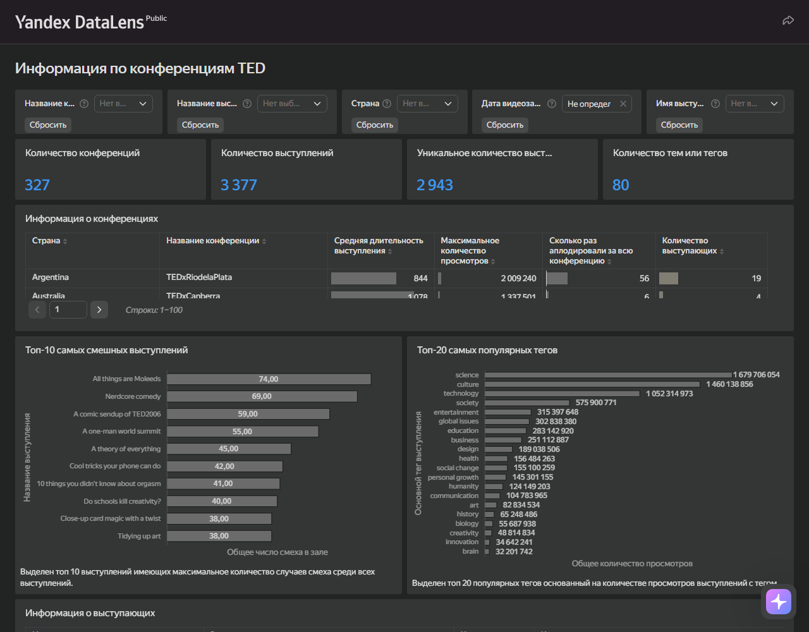

# Анализ конференций и выступлений TED

> Учебный проект. Дашборд опубликован в Yandex DataLens.

## Задача
Исследовать коллекцию конференций, выступлений и спикеров TED, популярные темы и заметные выступления.

## Данные и доступ
Интерактивный дашборд доступен по внешней ссылке. Данные проекта не включены в репозиторий.

## Подход
Собраны сводки по конференциям, выступлениям, спикерам и темам; добавлены фильтры по стране, названию, дате и спикеру, топ-10 выступлений по эпизодам смеха и топ-20 тегов по просмотрам.

## Результат
В дашборде 327 конференций, 3 377 выступлений, 2 943 уникальных спикера и 80 тем/тегов. Лидирующий тег science — около 1,68 млрд просмотров; первое место среди самых смешных выступлений — «All things are Moleeds» с 74 эпизодами смеха.

## Ограничения
Доступность дашборда зависит от Yandex DataLens; исходные данные для независимого пересчёта здесь не размещены.

## Файлы и стек
- `dashboard.png` — скриншот главной страницы.
- [Открыть дашборд в Yandex DataLens](https://datalens.yandex/q5ksri2yyzwmb).
- Yandex DataLens, интерактивная визуализация данных.
