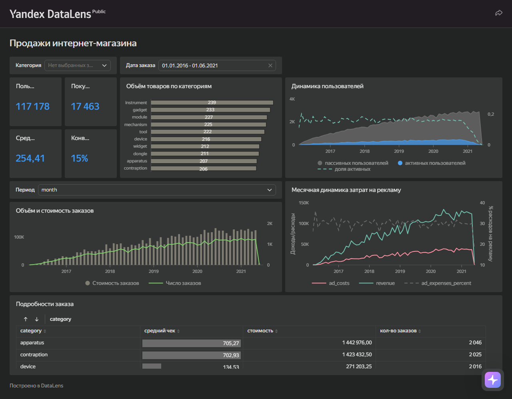

# Анализ продаж интернет-магазина

> Учебный проект по аналитике и визуализации в Yandex DataLens.

## Задача
Собрать интерактивное представление активности покупателей, заказов, выручки, конверсии и рекламных расходов с разрезами по времени и категориям.

## Данные и доступ
Дашборд опубликован в Yandex DataLens; исходные данные не включены в репозиторий.

## Подход
Сведены показатели покупателей, заказов и среднего чека; показаны динамика стоимости и числа заказов, категории, рекламные расходы и активность. Доступны фильтры по категории и периоду и табличная детализация.

## Результат
В дашборде отображаются 17 463 покупателя и 117 178 пользователей; общий средний чек — 254,41. В детализации суммарная стоимость заказов — 4 826 455,91 при 18 971 заказе, конверсия на KPI — 15%. Наибольший средний чек среди показанных категорий у `apparatus` — 705,27.

## Ограничения
Доступность дашборда зависит от внешнего сервиса; валюта показателей в исходном дашборде не уточнена.

## Файлы и стек
- `dashboard.png` — скриншот главной страницы.
- [Открыть дашборд в Yandex DataLens](https://datalens.yandex/r5yanufghjt0c?_share_link=public).
- Yandex DataLens, графики, фильтры и табличная детализация.
