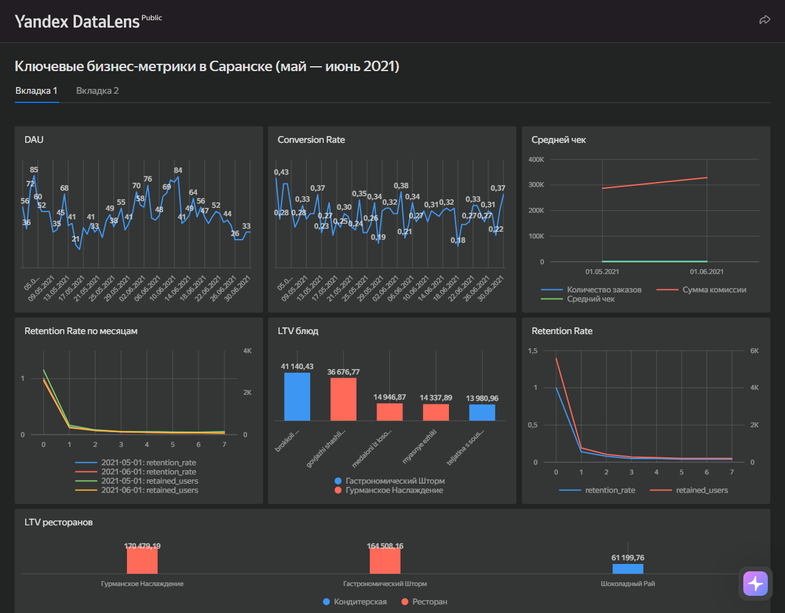

# Метрики сервиса доставки еды в Саранске

> Учебный аналитический проект. Исходная база не включена в репозиторий.

## Задача
Оценить активность, конверсию, средний чек, удержание и LTV сервиса «Всё.из.кафе» в Саранске за май–июнь 2021 года.

## Данные и доступ
Дашборд опубликован в Yandex DataLens. Исходная база в репозитории не размещается.

## Подход
В DataLens показаны DAU, конверсия, заказы, средний чек, retention на 1-й и 7-й день, когортные различия, LTV ресторанов и популярные блюда.

## Результат
Средний чек вырос с 135,88 ₽ в мае до 147,66 ₽ в июне (+8,7%); число заказов — с 2 111 до 2 225. Средняя конверсия — 29%; на 7-й день удерживалось 5% майской и 3% июньской когорты. Максимальный LTV ресторана — 170 479 ₽. Рекомендации и дополнительные выводы находятся на второй вкладке.

## Ограничения
Доступность DataLens зависит от внешнего сервиса; для повторного расчёта исходная база недоступна в репозитории.

## Файлы и стек
- `dashboard.png` — скриншот главной страницы.
- [Открыть дашборд в Yandex DataLens](https://datalens.yandex/jhc2qmgms5cy3).
- Yandex DataLens, продуктовые метрики, когортный анализ.
